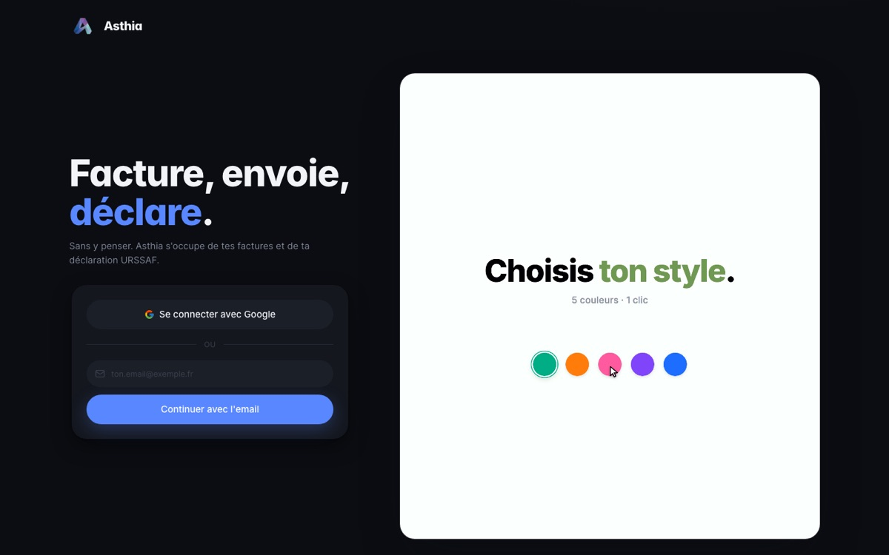
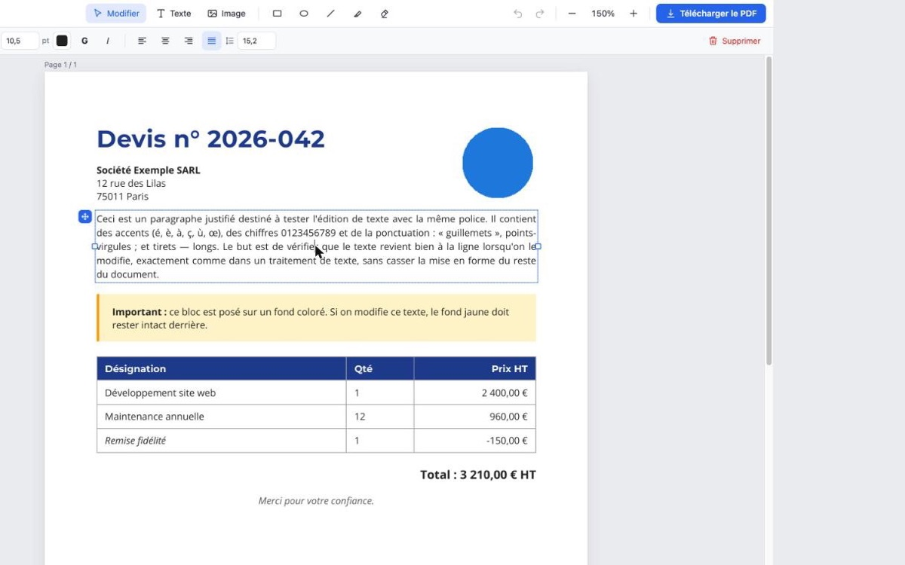
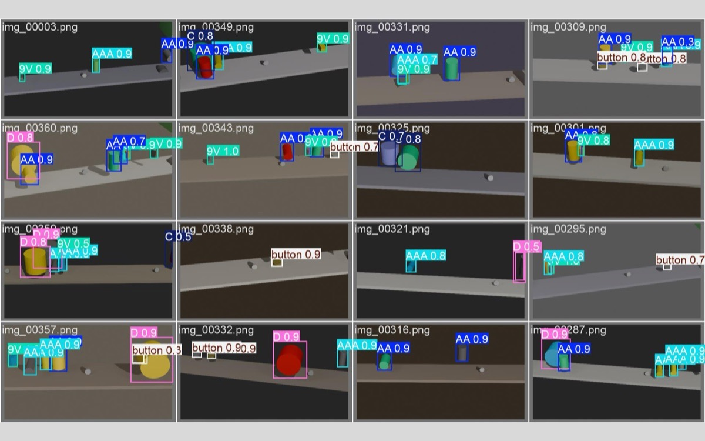
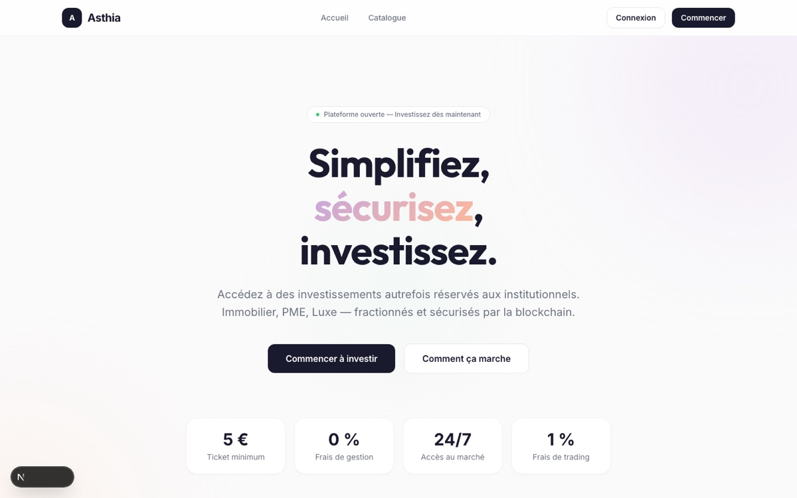
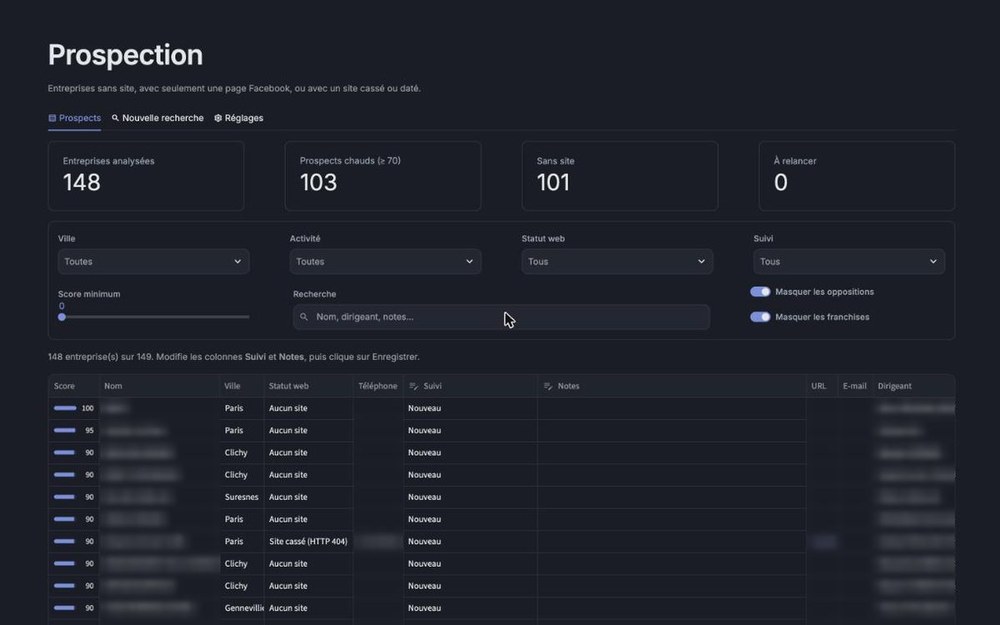
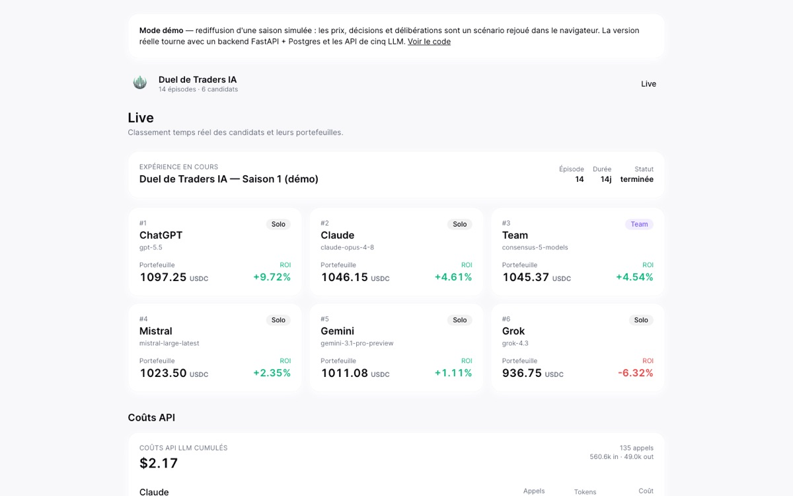
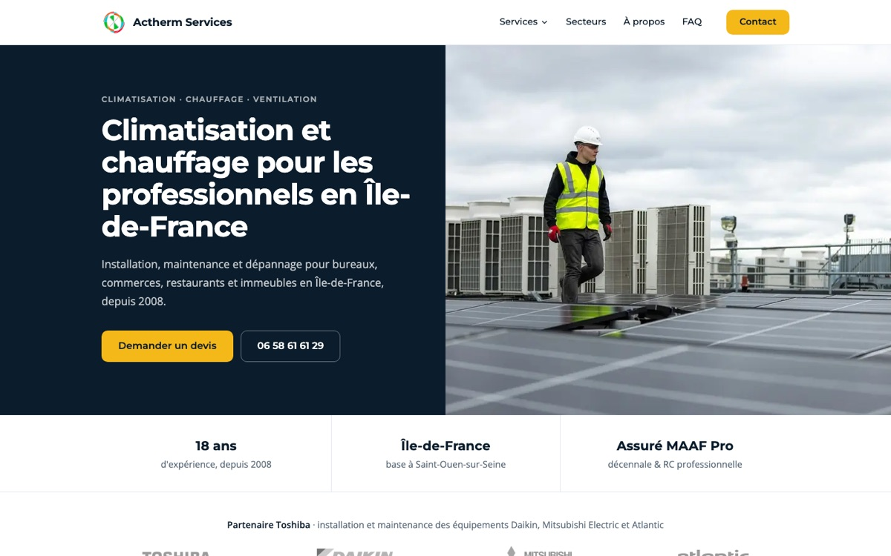

# Adrien Rabillat

Élève ingénieur en dernière année à l'ESILV (cybersécurité et cloud), en alternance chez un éditeur de logiciel de gestion pour le bâtiment.

[adrien@rabillat.fr](mailto:adrien@rabillat.fr) · [LinkedIn](https://www.linkedin.com/in/adrien-rabillat/) · anglais B2+

**Stack** : TypeScript, JavaScript, Python, Java, Kotlin, Solidity · React, Next.js, Tailwind, Eleventy, Streamlit · Node.js, FastAPI, Express · PostgreSQL, Supabase, Prisma, SQLite · Blender, YOLOv8 · Vercel, Netlify · Stripe, Resend, API d'IA (Anthropic, OpenAI, Mistral, Gemini)

---

## Projets phares

<table>
<tr>
<td width="50%" valign="top">

<h3>Asthia</h3>

Application de gestion pour auto-entrepreneurs : factures en PDF envoyées par e-mail, suivi des paiements et calcul automatique de la déclaration URSSAF.

Next.js · Supabase · Resend

<a href="https://www.asthia.fr">Site</a> · code privé

</td>
<td width="50%" valign="top">

<h3>Éditeur PDF local</h3>

On clique sur un texte d'un PDF pour le réécrire avec sa police d'origine, sans casser la mise en page. OCR des pages scannées, tout tourne en local.

Python · FastAPI · PyMuPDF · Apple Vision

<a href="https://github.com/adrienrabillat/editeur-pdf-local">Code</a>

</td>
</tr>
<tr>
<td width="50%" valign="top">

<h3>Tri de piles par vision IA</h3>

Une usine virtuelle Blender génère des images déjà annotées ; YOLOv8 entraîné dessus reconnaît 6 types de piles (92,9 % de mAP50). Projet en équipe.

Python · Blender · YOLOv8 · FastAPI · React

<a href="https://github.com/adrienrabillat/tri-de-piles-vision-ia">Code</a>

</td>
<td width="50%" valign="top">

<h3>Crowdfunding sur blockchain</h3>

Investissement fractionné dans des actifs réels : un jeton ERC-20 par actif, paiement en euros, remboursement si l'objectif n'est pas atteint.

Solidity · Hardhat · Express · Next.js · Stripe

<a href="https://github.com/adrienrabillat/plateforme-crowdfunding-blockchain">Code</a>

</td>
</tr>
<tr>
<td width="50%" valign="top">

<h3>Prospection de sites web</h3>

Repère les entreprises d'une zone sans site, avec une simple page Facebook ou un site daté : registres publics, détection du CMS, score et suivi. En cours.

Python · Streamlit · API Recherche d'entreprises · SQLite

<a href="https://github.com/adrienrabillat/prospection-sites-web">Code</a>

</td>
<td width="50%" valign="top">

<h3>Duel de Traders IA</h3>

Cinq IA (Claude, GPT, Mistral, Gemini, Grok) s'affrontent en trading crypto pendant 14 épisodes : stratégies, alliances et délibérations d'équipe.

FastAPI · PostgreSQL · Next.js · 5 API de LLM

<a href="https://duel-traders-ia.vercel.app">Démo</a> · <a href="https://github.com/adrienrabillat/duel-traders-ia">Code</a>

</td>
</tr>
</table>

## Autres réalisations en ligne

<table>
<tr>
<td width="50%" valign="top">

<b>Actherm Services</b> 
Site d'une entreprise de climatisation et espace bons de commande : les devis sont lus par une IA (Mistral) qui pré-remplit le bon. 
Netlify Functions · Mistral · SEO local 
<a href="https://acthermservices.com">Site</a> · projet client
</td>
<td width="50%" valign="top">

<b>Sophrologue à Clichy</b> 
Site optimisé pour le référencement local et les moteurs de réponse IA, prise de rendez-vous synchronisée avec l'agenda. 
Eleventy · Tailwind · Netlify · Resend 
<a href="https://sophrologie-cfriderich.fr">Site</a> · projet client
</td>
</tr>
</table>

### Maquettes de sites vitrines

Propositions de refonte réalisées pour des commerces locaux (non officielles, non indexées).

<table>
<tr>
<td width="33%" valign="top">

<b>Auto-école Cosmos</b> 
React · react-router · SEO 
<a href="https://maquette-auto-ecole-cosmos.vercel.app">Démo</a> · <a href="https://github.com/adrienrabillat/maquette-auto-ecole-cosmos">Code</a>
</td>
<td width="33%" valign="top">

<b>Auto-moto-école AME</b> 
React 19 · Vite · Tailwind 4 
<a href="https://maquette-auto-ecole-ame.vercel.app">Démo</a> · <a href="https://github.com/adrienrabillat/maquette-auto-ecole-ame">Code</a>
</td>
<td width="33%" valign="top">

<b>Bistrot Maison Cambon</b> 
React · Vite 
<a href="https://maquette-bistrot-maison-cambon.vercel.app">Démo</a> · <a href="https://github.com/adrienrabillat/maquette-bistrot-maison-cambon">Code</a>
</td>
</tr>
</table>

---

## Autres projets

| Projet | Description | Stack |
|---|---|---|
| [allurae-boutique-mode](https://github.com/adrienrabillat/allurae-boutique-mode) | Boutique e-commerce de mode complète : catalogue, panier, paiement, livraison, back-office | Next.js, Prisma, Stripe, Better Auth |
| [coach-de-poche](https://github.com/adrienrabillat/coach-de-poche) · [démo](https://coach-de-poche.vercel.app) | Suivi d'entraînement et de nutrition : programme par séance, charges, pesées, export pour analyse | React, Vite, Supabase |
| [frigomalin-app-recettes](https://github.com/adrienrabillat/frigomalin-app-recettes) | Application Android qui propose des recettes à partir des ingrédients disponibles (projet de groupe) | Kotlin, MVVM, Retrofit |
| [gestion-stock-boutique-java](https://github.com/adrienrabillat/gestion-stock-boutique-java) | Application de bureau de gestion de stock et de finances pour une boutique | Java, JavaFX, MySQL, DAO |
| Skills 4D View Pro (code privé) | Kit Claude Code qui conçoit des états 4D View Pro à partir d'un tableau Excel : commandes personnalisées, outils Python de contrôle, bibliothèque de blocs enrichie à chaque état validé | Claude Code, Python, 4D |
